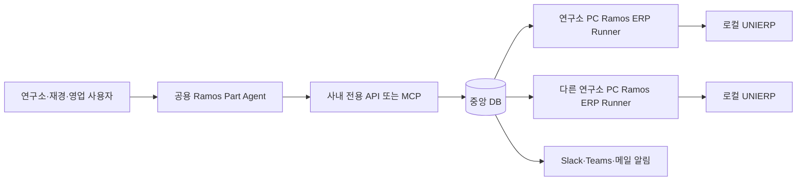
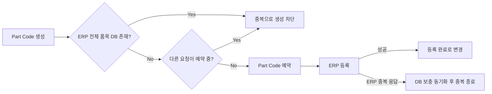

# Ramos Part / ERP Full Auto Preview 프로젝트 구상안

- 문서 상태: Preview 설계 초안
- 작성일: 2026-08-07
- 대상 범위: DRAM Part 우선
- 궁극적 목표: Part 요청부터 ERP 등록까지의 Full Auto 체계

## 1. 문서 목적

현재 `RamosPartGenerator`는 DRAM Part Code의 생성, 파싱, 검증과 등록용 Excel Export를 지원하는 Windows 프로그램이다.

향후 목표는 다음 업무를 하나의 흐름으로 연결하는 것이다.

1. 누군가가 Part 생성을 요청한다.
2. 연구소가 Part와 연관된 PID, MFGID, BIN Part 등을 한 묶음으로 생성한다.
3. 재경 및 영업 필드가 각 부서 규칙에 따라 자동 계산된다.
4. 자동 필수 검증 후 ERP에 등록한다.
5. 재경과 영업 담당자에게 등록 결과와 확인 요청을 알린다.
6. 담당자는 잘못된 값을 직접 수정하거나 전체 규칙을 수정한다.
7. 변경 이력, 확인 여부, ERP 반영 결과를 추적한다.
8. 검증된 범위를 점차 확대하여 사람의 확인 없이 ERP 등록까지 완료한다.

이 문서는 지금까지 확인된 자료와 논의를 기준으로 Preview 단계의 방향을 정리한다. 상세 필드 로직과 최종 기술 구성은 추가 자료 확보 후 확정한다.

## 2. 현재 확인된 사실

### 2.1 현재 Part Generator

- C# WinForms 기반 단일 실행 프로그램이다.
- Part 생성·파싱·검증 Core가 UI와 분리돼 있다.
- `specs/shared.json`, `specs/rev30.json`에서 규칙 일부를 읽는다.
- Incoming, Comp, Comp BIN, MDL, MDL BIN, Dummy/Repair 관련 Part와 LPDDR 입고/Product Part를 생성한다.
- 등록용 Excel Export 기능이 있다.
- ERP 품목 Excel 업로드와 PGM Export 이력으로 생성 결과의 `등록됨`/`신규`를 판정하고, Export 시 등록 파트를 기본 제외한다 (단일·일괄 탭 공통, v1.5.1 기준).
- 현재 생성 결과 모델은 품목코드, 품목명, 품목일반정보, 품목규격 중심이다.
- MDL Export의 영업코드는 열만 존재하고 실제 계산 로직은 아직 없다.
- v1.5.1 기준 테스트는 121개가 통과하는 상태다.

### 2.2 ERP 등록 결과 Excel

`docs/품목정보등록(Multi)(S).xlsx`는 ERP에서 가져온 결과물이다.

- 단일 예시 행에 총 87개 필드가 있다.
- Excel 내부 수식은 없다.
- 등록 전에는 재경에서 별도 Excel과 수식을 사용한다.
- 재경 Excel에서 계산된 행을 복사하여 ERP에 붙여 넣는 방식이다.
- 현재 파일은 값 결정 로직이 아니라 ERP에 들어간 최종 결과 예시다.
- 향후 다량의 전 제품군 ERP Export를 확보할 수 있다.

주요 필드 그룹은 다음과 같다.

| 영역 | 예시 필드 |
|---|---|
| 기본 품목 | 품목코드, 품목명, 품목영문명, 품목일반정보, 품목규격, 단위, 품목계정 |
| 분류·회계 | 사업부, 부문, 제품군, 세대구분, Die 기반 분류, 품목그룹, 품목클래스 |
| 운영 속성 | 팬텀, 통합구매, 대리점품목, 경비배부, 기준품목, 유효기간 |
| 영업 | 영업코드 여부, Market 가격분류, 영업코드 |
| 물류·무역·재경 | 중량, CBM, H/S 코드, 부가세, COO |
| 제품 상세 | Product 대/중/소, Speed Mode, Rank, Die Gen, Assy Site, PKG, Voltage, Density, Config |
| 기타 | Remark, 비고, 여분 컬럼 |

87개 필드가 모두 직접 입력 대상이라는 뜻은 아니다. 코드 입력 후 ERP가 명칭을 자동 표시하는 필드, 읽기 전용 필드, 기본값, 제품군 미사용 필드를 구분해야 한다.

### 2.3 ERP 연동 방식

- ERP 공식 API는 없다.
- Windows ERP 프로그램을 직접 실행하고 화면을 조작해야 한다.
- ERP 자체에서도 중복 품목코드 등록은 차단된다.
- 등록 취소, 삭제, 비활성화 및 사후 수정이 가능한 것으로 파악된다.
- ERP와 MES는 각 담당자 PC에 설치되어 사용된다.
- `C:/JSH_Folder/PGM/MES_ERP_Auto`에 MES 화면 자동화 프로그램이 존재한다.
- 기존 MES 자동화는 Windows UI Automation을 우선 사용하고 `SendKeys`, 마우스 좌표, 포그라운드 전환을 보조적으로 사용한다.
- 이 구조를 ERP 자동 등록에 참고할 예정이다.

### 2.4 Part 규격 PDF

`docs/RAMOS_DRAM_PART (Rev.30.3).pdf`는 16페이지로 구성되어 있으며 Part 위치별 코드와 설명을 텍스트로 추출할 수 있다.

PDF 업로드를 통해 현재 규칙과 신규 규격의 차이를 찾고 규칙 변경 후보를 생성하는 기능을 만들 수 있다. 다만 파일명, PDF 메타데이터, 본문 Revision 표기가 서로 다를 수 있으므로 자동 활성화는 금지하고 담당자 검토를 거쳐야 한다.

## 3. 현재 합의된 운영 원칙

### 3.1 ERP 등록 우선, 재경·영업 사후 확인

속도를 위해 재경과 영업의 확인을 ERP 등록 선행조건으로 두지 않는다.

- Part 생성 후 자동 필수 검증을 통과하면 ERP에 먼저 등록한다.
- 등록 완료 후 재경과 영업에 확인 요청을 보낸다.
- 확인하지 않은 담당자와 경과 시간을 기록한다.
- 잘못된 값은 담당자가 확인 시점에 수정한다.
- 필요하면 ERP 등록 후 담당자가 직접 수정할 수 있다.
- 시스템은 누가 언제 통보받고 확인했는지 남긴다.

반려 또는 빠꾸보다는 `미확인`, `확인`, `수정 필요`, `수정 완료` 상태를 사용한다.

### 3.2 사후 확인으로 넘기지 않을 자동 차단 항목

다음 항목은 재경·영업 판단과 별개로 ERP 등록 전에 자동 차단한다.

- 동일 품목코드가 ERP 전체 품목 DB에 존재
- 동일 품목코드가 다른 요청에서 예약 또는 등록 중
- Part Code 구조가 규격에 맞지 않음
- PID와 MFGID 연결이 모순됨
- ERP 필수 필드 누락
- 필드 길이 또는 자료형 오류
- 품목코드와 제품분류 불일치
- 여러 규칙이 충돌하여 값을 하나로 결정할 수 없음
- 대상 ERP 창 또는 조회 결과가 예상과 다름

업무 판단은 사후 확인할 수 있지만 중복, 식별자, 필수값, 구조 오류는 등록 전에 막는다.

### 3.3 한 요청은 여러 Part의 묶음

한 요청에서 다음 항목들이 함께 생성될 수 있다.

- 기본 PID
- MFGID
- Incoming
- Comp
- Comp BIN
- MDL
- MDL BIN
- Dummy
- Repair/Reball 관련 Part

따라서 데이터 구조는 `요청 1건 = Part 1개`가 아니라 `요청 1건 = 여러 요청항목과 여러 생성 Part`로 설계한다. 담당자는 관련 Part 전체를 한 화면 또는 한 에이전트 응답에서 동시에 확인하고 묶음 단위로 처리할 수 있어야 한다.

## 4. Preview 권장 구조: Agent First

정식 웹 업무 화면을 먼저 개발하지 않고 에이전트를 사용자 인터페이스로 사용하는 방안을 우선 검토한다.



사용자는 별도 웹 화면 대신 에이전트에게 자연어로 요청한다.

- 신규 DDR5 Module 요청 생성
- 관련 PID와 MFGID 묶음 표시
- ERP 87개 필드 산출 근거 표시
- 내 PC에서 ERP 등록 시작
- 재경 미확인 목록 표시
- 이번 건의 특정 값만 수정
- 앞으로 적용할 재경 또는 영업 규칙 수정
- 신규 PDF와 현재 규칙 비교
- 특정 Part가 ERP에 이미 있는지 확인

에이전트는 사용자 인터페이스이며, 실제 업무 데이터와 상태의 기준은 중앙 DB다.

## 5. 공용 에이전트와 계정 운용

### 5.1 공용 계정 공유 방식은 사용하지 않음

공용 아이디 하나를 여러 사람이 같이 사용하는 방식은 다음 이유로 부적합하다.

- 수정자와 실행자를 구분할 수 없다.
- 연구소·재경·영업 권한을 분리할 수 없다.
- 비밀번호와 인증수단 공유 문제가 생긴다.
- 부서 이동 또는 퇴사 시 접근 회수가 어렵다.
- 대화와 업로드 자료가 한 사용자처럼 섞인다.
- 감사 이력과 책임 소재가 불명확해진다.

### 5.2 권장 방식

- 회사 ChatGPT Workspace를 만든다.
- 각 담당자를 개인 회사 계정으로 초대한다.
- 하나의 `Ramos Part Agent`를 관련 그룹에 공개한다.
- 각 사용자는 자기 계정과 자기 대화에서 동일한 에이전트를 사용한다.
- 에이전트 설정과 도구는 공용이지만 대화는 사용자별이다.
- 모든 에이전트 대화는 같은 중앙 DB를 조회한다.

예시 구조:

```text
회사 ChatGPT Workspace
├─ 시스템 제작자 / 전체 관리자
├─ 연구소 담당자 A
├─ 연구소 담당자 B
├─ 재경 담당자
├─ 영업 담당자
└─ 공용 Ramos Part Agent
```

ChatGPT Business Workspace는 관리자 한 명만 결제하고 나머지를 무료 초대하는 구조가 아니라 사용자별 유료 좌석 구조다.

2026-08-07 확인 기준:

- 최소 2명 이상
- 연간 결제: 사용자당 월 $20
- 월 결제: 사용자당 월 $25
- Enterprise/Edu: 별도 계약
- 가격과 제공 기능은 이후 변경될 수 있으므로 도입 시 공식 페이지 재확인 필요

공식 참고:

- https://learn.chatgpt.com/docs/pricing
- https://learn.chatgpt.com/docs/enterprise/roles-and-workspace-permissions
- https://learn.chatgpt.com/docs/enterprise/work-admin-faq

### 5.3 Business Workspace를 사용하지 않는 대안

OpenAI API를 사용해 Ramos 전용 Agent를 직접 만들고 Slack, Teams 또는 사내 프로그램에서 사용할 수 있다.

장점:

- 사용자별 ChatGPT Business 좌석 없이 API 사용량 기준으로 운영 가능
- 회사 인증 및 부서 권한을 직접 적용 가능
- Slack/Teams 알림과 업무 처리를 한곳에 구성 가능

단점:

- 로그인, 권한, 대화 UI, 기록, 알림을 직접 개발해야 함
- 중앙 API와 Agent 실행 환경을 별도로 운영해야 함

Preview 시점에는 Business Workspace의 실제 참여 인원과 좌석 비용을 계산한 뒤 `Workspace Agent`와 `API 기반 사내 Agent`를 비교한다.

## 6. 사용자별 실제 운용 흐름

### 6.1 연구소 담당자

1. 자기 계정으로 Ramos Part Agent를 연다.
2. 신규 Part 요청을 생성한다.
3. 에이전트가 기존 Part Generator Core로 Part 묶음을 생성한다.
4. 중앙 DB에서 기존 ERP 품목과 진행 중 예약을 검사한다.
5. 재경·영업 필드를 현재 규칙으로 계산한다.
6. 등록 전 자동 필수 검증 결과를 보여준다.
7. 연구소 담당자가 자기 PC에서 ERP 등록을 시작한다.
8. 로컬 Runner가 ERP 화면을 자동 조작한다.
9. 성공 또는 실패 결과가 중앙 DB에 기록된다.
10. 성공 시 재경·영업 확인 작업과 알림이 생성된다.

### 6.2 재경 담당자

1. Slack, Teams 또는 메일로 신규 등록 알림을 받는다.
2. 자기 계정으로 Ramos Part Agent를 연다.
3. 재경 미확인 건을 조회한다.
4. 현재 값, 산출 근거, 사용 규칙을 확인한다.
5. 잘못된 값은 직접 수정한다.
6. 이번 건만 수정할지 전체 규칙도 변경할지 선택한다.
7. 재경 확인 상태로 변경한다.

### 6.3 영업 담당자

재경과 동일한 방식으로 영업 소유 필드와 영업 규칙을 확인하고 수정한다.

### 6.4 시스템 제작자

- 모든 부서 규칙과 필드를 조회·관리한다.
- ERP 등록 실패와 미확인 현황을 조회한다.
- 규칙 버전과 변경 영향을 확인한다.
- 사용자와 권한을 관리한다.
- 시스템 및 Runner 버전을 관리한다.

## 7. 업무 상태 모델

### 7.1 요청/등록 묶음 상태

- `DRAFT`: 작성 중
- `GENERATED`: Part 묶음 생성 완료
- `VALIDATING`: 자동 검증 중
- `READY_FOR_ERP`: ERP 등록 준비 완료
- `ERP_REGISTERING`: ERP 등록 중
- `ERP_REGISTERED`: ERP 등록 완료
- `ERP_FAILED`: ERP 등록 실패
- `CORRECTION_REQUIRED`: 사후 수정 필요
- `CORRECTION_COMPLETED`: 수정 완료
- `CANCELLED`: 요청 취소

### 7.2 부서 확인 상태

- `NOT_NOTIFIED`: 미통보
- `NOTIFIED`: 통보 완료
- `UNSEEN`: 미열람
- `SEEN`: 열람
- `CONFIRMED`: 확인 완료
- `CORRECTING`: 수정 중
- `CORRECTED`: 수정 완료
- `OVERDUE`: 확인 기한 초과

재경과 영업의 확인 상태는 ERP 등록 상태와 분리한다. 두 부서가 미확인이어도 정책상 ERP 등록은 완료될 수 있다.

## 8. 중앙 DB 설계 방향

14,000개 수준의 ERP 품목은 MySQL, PostgreSQL, SQL Server 모두 충분히 처리할 수 있다. 데이터 건수보다 변경 이력, 동시 사용, 권한, 중복 예약, ERP 재시도가 DB 도입의 핵심 이유다.

### 8.1 주요 데이터 영역

#### ERP 전체 품목 미러

- 모든 제품군의 ERP 품목
- 품목코드와 87개 필드
- 활성/비활성/삭제 상태
- ERP Export 기준일
- 처음 발견한 시점과 마지막 발견 시점
- 이전 Export 대비 변경 내용

#### 자동화 대상 범위

- 초기에는 DRAM만 Full Auto 대상
- 다른 제품군은 조회와 중복 검사에만 사용
- 검증된 제품군부터 단계적으로 자동화 범위 확대

#### 신규 요청과 등록 묶음

- 요청자와 요청 부서
- 요청 목적과 입력값
- 생성된 PID/MFGID/관련 Part
- 사용한 규칙 버전
- ERP 등록 상태
- 재경·영업 확인 상태
- 수정 이력

### 8.2 주요 테이블 후보

- `users`
- `departments`
- `roles`
- `user_roles`
- `part_requests`
- `request_items`
- `part_bundles`
- `parts`
- `part_versions`
- `part_code_registry`
- `field_definitions`
- `field_values`
- `rule_sets`
- `rule_versions`
- `rule_definitions`
- `department_reviews`
- `notifications`
- `erp_import_batches`
- `erp_registration_jobs`
- `erp_registration_attempts`
- `erp_change_diffs`
- `audit_events`

## 9. 품목코드 중복 방지

ERP 전체 Export를 DB에 적재하고 신규 코드 생성 시 비교한다.



중복 검사 시 다음 정규화를 적용한다.

- 앞뒤 공백 제거
- 대소문자 통일
- 허용되지 않은 공백 제거
- 하이픈 위치 정규화

`part_code_registry` 상태 예시:

- `ERP_EXISTING`
- `RESERVED`
- `REGISTERING`
- `REGISTERED`
- `FAILED`
- `CANCELLED`
- `INACTIVE`

ERP 외부에서 직접 등록한 품목은 다음 전체 Export까지 DB에 없을 수 있다. 이 경우 ERP 자체 중복 검사를 최종 안전망으로 사용하고, 발견한 품목을 DB에 즉시 반영한다.

## 10. ERP 필드와 부서별 권한

각 ERP 필드에는 다음 메타데이터가 필요하다.

- ERP 필드 ID
- 한글명과 영문명
- 자료형과 최대 길이
- 필수 여부
- 코드 또는 자유 입력 여부
- ERP 직접 입력/ERP 자동 표시/읽기 전용 구분
- 소유 부서
- 조회 가능 부서
- 수정 가능 부서
- 규칙 관리 가능 부서
- 입력값 출처
- 기본값
- 허용값
- 다른 필드와의 의존 관계
- ERP 제품군별 사용 여부

권한 예시:

- 연구소: Part Code, 품목규격, Die, Density, Speed 등
- 재경: 품목계정, 부가세, 경비배부 등
- 영업: 영업코드, Market 가격분류 등
- 전체 관리자: 모든 필드와 규칙

정확한 부서 소유권은 담당자 인터뷰 후 확정한다.

최종 필드값은 관련 부서가 함께 볼 수 있게 하는 것을 기본으로 하고, 규칙 관리 및 수정 권한은 부서별로 제한한다. 민감 필드가 있다면 조회 권한도 별도로 제한한다.

## 11. 값 수정과 규칙 수정의 구분

담당자가 오류를 발견했을 때 반드시 두 가지 수정 범위를 구분한다.

### 11.1 이번 건만 수정

- 현재 Part 또는 등록 묶음의 값만 변경
- 규칙에는 영향 없음
- 변경 전 값, 변경 후 값, 수정자, 사유 기록
- 특수한 예외 Part에 사용

### 11.2 앞으로의 규칙 수정

- 새 규칙 버전 생성
- 적용 조건과 결과값 입력
- 이전 규칙과 차이 표시
- 대표 Part 자동 테스트
- 영향 받는 미등록 요청과 기존 Part 수 표시
- 담당자 확인 후 시행일 지정 및 활성화

예외 한 건의 수정이 전체 규칙을 잘못 바꾸지 않도록 두 기능을 화면과 명령에서 명확히 분리한다.

## 12. 규칙 관리 생명주기

규칙은 단순 추가·수정·삭제가 아니라 다음 상태를 가진다.

`작성 중 → 테스트 중 → 승인/확정 → 적용 예약 → 사용 중 → 폐기`

규칙의 실제 삭제는 금지하고 비활성 또는 폐기로 처리한다. 과거 Part가 당시 어떤 규칙으로 생성됐는지 재현할 수 있어야 한다.

첫 규칙 관리 범위:

- 코드 목록
- 코드 간 허용 조합
- 필수/선택 조건
- 입력값과 결과값 매핑
- 기본값
- 문자열 조합 순서
- 수치 계산식
- ERP 필드 매핑

복잡한 특수 로직은 초기에는 코드에 유지하고 동일한 버전·테스트·변경 이력 절차를 적용한다.

## 13. PDF 기반 Part 규칙 보완


자동으로 만들 수 있는 결과:

- 신규 코드 후보
- 설명이 변경된 코드
- 사라진 코드 또는 비활성 후보
- Part 위치 정의 변경
- 기존 프로그램 규칙과 PDF 충돌
- 변경 전/후 대표 Part 결과
- 영향을 받는 기존 Part 목록

PDF는 규칙 변경안을 만드는 자료로 사용하고 운영 규칙에 즉시 자동 적용하지 않는다.

## 14. 대량 ERP Export 기반 규칙 탐색

전체 제품군 또는 다량의 DRAM 품목을 Export하면 에이전트가 다음 규칙 후보를 탐색할 수 있다.

1. Part Code를 현재 생성기로 파싱한다.
2. Part 속성과 ERP 87개 필드를 연결한다.
3. 제품군별로 그룹화한다.
4. 항상 동일한 상수 필드를 찾는다.
5. Part 특정 위치와 ERP 값의 상관관계를 찾는다.
6. 복수 조건으로 결정되는 필드를 찾는다.
7. 가장 일반적인 규칙과 반례를 함께 표시한다.
8. 규칙 후보별 일치율과 신뢰도를 계산한다.
9. 재경·영업 담당자가 공식 규칙으로 확정한다.

자료별 역할:

- 재경 관리 Excel 수식: 의도된 현재 로직
- ERP 전체 Export: 실제 등록 결과와 과거 예외
- 담당자 설명: 최신 정책, 예외, 우선순위
- Part 규격 PDF: 공식 Part Code 체계

과거 ERP 데이터에는 오등록, 예외, 옛 규칙이 포함될 수 있으므로 데이터에서 발견한 패턴은 자동 확정하지 않고 `규칙 후보`로 관리한다.

## 15. 연구소 PC별 ERP Runner

별도의 ERP 전용 PC를 반드시 구매할 필요는 없다. 연구소 담당자가 자기 PC에서 ERP 자동 등록을 시작하면 해당 PC가 작업 시간 동안 임시 자동화 실행기가 된다.

실행 흐름:

1. 에이전트가 중앙 DB에 ERP 등록 작업을 생성한다.
2. 연구소 PC의 Ramos ERP Runner가 작업을 내려받는다.
3. ERP 설치, 로그인, 창 제목, DPI, 해상도, Runner 버전을 사전 검사한다.
4. 사용자에게 작업 중 마우스와 키보드를 사용하지 말라는 안내를 표시한다.
5. ERP 프로그램을 실행하거나 기존 창에 연결한다.
6. 등록 묶음을 순차 입력한다.
7. 각 Part 처리 결과와 스크린샷을 기록한다.
8. 성공 또는 실패 결과를 중앙 DB에 전달한다.
9. 작업 종료 후 PC를 정상 사용 상태로 돌린다.

필수 안전 기능:

- 한 PC에서 하나의 ERP 등록 작업만 실행
- 한 Part Code에 하나의 등록 작업만 실행
- 안전한 중단 지점
- 긴급 정지 기능
- 예상하지 않은 팝업 발생 시 중단
- ERP 대상 창 확인
- 포커스 이탈 감지
- 입력 전후 값 대조
- 실패 지점과 재시작 위치 기록
- ERP 자격증명은 로컬 암호화 저장

Windows의 입력을 완전히 차단하는 방식은 긴급 정지까지 막을 수 있으므로 기본안으로 사용하지 않는다. 전체 화면 진행 안내와 전용 실행 시간 운영을 우선한다.

## 16. 알림 설계

에이전트는 미확인 목록을 조회하고 설명할 수 있지만 사용자가 에이전트를 열지 않으면 능동적인 알림을 놓칠 수 있다.

권장 역할 분리:

- 에이전트: 조회, 수정, 규칙 설명, 확인 처리
- Slack/Teams/사내 메일: 신규 등록과 미확인 알림
- 중앙 DB: 실제 통보·열람·확인 이력

알림 예시:

```text
[ERP 등록 완료] PR-2026-0025
Part 8건 / MFGID 12건
실행자: 연구소 김OO
등록 시각: 2026-08-07 14:32
재경: 미확인
영업: 미확인
```

채널 구성 예시:

- 공용 채널: 전체 등록 결과와 진행 현황
- 재경 개인 또는 부서 채널: 재경 확인 대상
- 영업 개인 또는 부서 채널: 영업 확인 대상
- 시스템 관리자 채널: ERP 실패, 규칙 충돌, Runner 장애

권장 우선순위:

1. 회사가 이미 사용하는 Slack 또는 Teams
2. 사내 메일
3. 별도 사내 알림 프로그램
4. Telegram 또는 카카오톡은 회사 보안 정책 확인 후

## 17. 감사 및 책임 추적

다음 이벤트를 모두 기록한다.

- 요청 생성자와 생성 시각
- Part 생성 입력값과 결과
- 사용한 규칙 버전
- ERP 자동 등록 실행자와 PC
- ERP 처리 시작·완료·실패 시각
- 담당자별 알림 발송 시각
- 담당자별 열람과 확인 시각
- 확인 기한 초과
- 필드 변경 전/후 값
- 수정자와 수정 사유
- 이번 건 수정인지 규칙 수정인지
- ERP 사후 직접 수정 여부
- 전체 Export에서 발견된 ERP와 DB 차이

목표는 잘못된 등록이 발생했을 때 감정이나 기억이 아니라 기록으로 원인과 처리 지점을 확인하는 것이다.

## 18. ERP 전체 품목 동기화

ERP API가 없으므로 초기에는 전체 Export 업로드 방식으로 동기화한다.

`ERP 전체 Export 업로드 → 형식 검증 → 이전 배치와 비교 → 신규/변경/미존재 후보 표시 → DB 반영`

주의 사항:

- 새 Export에 없다는 이유만으로 기존 품목을 즉시 삭제하지 않는다.
- 사용 안 함, 비활성, 삭제 상태를 구분한다.
- Export 기준일과 원본 파일을 기록한다.
- ERP에서 직접 수정한 값은 이전 스냅샷과 비교해 변경 이력으로 저장한다.
- 시스템에서 ERP 등록 성공 시 다음 전체 Export를 기다리지 않고 DB에 즉시 등록 완료로 반영한다.

## 19. 단계별 구축안

### Phase 0. 자료 수집과 규칙 조사

- 재경 관리 Excel과 수식 확보
- 영업 필드 로직 확보
- 다량의 ERP 전체 품목 Export 확보
- Incoming/Comp/MDL/MFGID 등 대표 사례 수집
- ERP 입력 대상 필드와 자동 표시 필드 구분
- MES 자동화에서 재사용할 실행·로그·안전 패턴 정리

### Phase 1. 로컬 Preview

- 현재 Part Generator Core 재사용
- ERP 전체 품목 DB Import
- 품목코드 중복 및 예약 검사
- 등록 묶음 생성
- 한 연구소 PC에서 ERP 자동 등록 시험
- 결과 로그와 스크린샷 저장

### Phase 2. 중앙 DB와 Agent Tool

- 중앙 DB 구축
- 사내 API 또는 MCP 구축
- 공용 Ramos Part Agent 연결
- 사용자와 부서 권한 적용
- 요청, 등록, 확인, 수정 이력 저장

### Phase 3. 알림과 사후 확인

- Slack/Teams/메일 연결
- 재경·영업 미확인 관리
- 확인 기한과 재알림
- 이번 건 값 수정
- 규칙 수정 후보 생성

### Phase 4. 규칙 관리

- 연구소·재경·영업 규칙 영역 분리
- 규칙 버전, 시행일, 테스트, 영향 분석
- PDF 업로드 비교
- 대량 ERP Export 기반 규칙 후보 생성

### Phase 5. Full Auto 확대

- 검증된 DRAM 유형 자동 등록
- 사후 오류율과 수정률 측정
- 자동화 범위 확대
- 다른 제품군은 별도 검증 후 추가

## 20. 추가로 필요한 자료

자료가 준비되는 시점에 순차적으로 확인한다.

- 재경에서 현재 사용하는 수식 Excel
- 영업 담당 필드와 결정 로직
- 다량의 전 제품군 ERP Export
- Incoming 예시
- Comp 및 Comp BIN 예시
- MDL 및 MDL BIN 예시
- MFGID가 여러 개 생성되는 사례
- Repair/Dummy/Reball 사례
- ERP에서 사후 수정한 사례
- 사용하지 않는 Part와 비활성 Part 사례
- ERP 등록 오류 사례
- ERP 실제 등록 화면과 입력 순서

## 21. 아직 결정되지 않은 사항

- ChatGPT Business Workspace 도입 여부
- API 기반 사내 Agent 직접 개발 여부
- 실제 참여 사용자 수와 좌석 비용
- Slack, Teams, 사내 메일 중 알림 채널
- 중앙 DB 제품과 설치 위치
- DB/Agent 서버를 물리 PC 또는 VM 중 어디에 둘지
- ERP 전체 Export 주기
- 재경·영업 확인 기한과 재알림 정책
- 담당자 부재 시 대체 담당자
- ERP 사후 직접 수정 내용을 DB에 반영하는 절차
- 87개 필드의 실제 입력/자동 표시/읽기 전용 구분
- 각 필드의 최종 소유 부서
- `114` 등 반복 기본값의 실제 의미
- 각 연구소 PC의 ERP 환경 표준화 범위

## 22. 현재 권장 결론

Preview 단계에서는 다음 구성이 현재 요구에 가장 잘 맞는다.

- DRAM Part부터 시작
- 에이전트를 주요 사용자 인터페이스로 사용
- 공용 계정 공유가 아니라 사용자별 회사 계정 사용
- 공용 Agent는 동일하고 대화는 사용자별로 운영
- 업무 데이터와 이력은 중앙 DB에서 공유
- ERP 전체 품목 DB와 신규 코드 예약으로 중복 차단
- 연구소 담당자 PC에서 ERP 자동 등록 실행
- ERP 등록 후 재경·영업 사후 확인
- 자동 필수 검증은 등록 전에 수행
- 값 수정과 전체 규칙 수정을 명확히 분리
- 알림은 Slack/Teams/사내 메일을 별도 채널로 사용
- PDF와 대량 Excel은 자동 적용이 아니라 규칙 후보 생성에 사용
- 사용 불편이 확인되는 영역만 추후 작은 웹 관리 화면으로 보완

에이전트는 업무의 앞단이지만 시스템의 기준 데이터는 아니다. 중앙 DB가 품목, 상태, 규칙, 확인, 수정, ERP 결과의 최종 기준이 된다.
